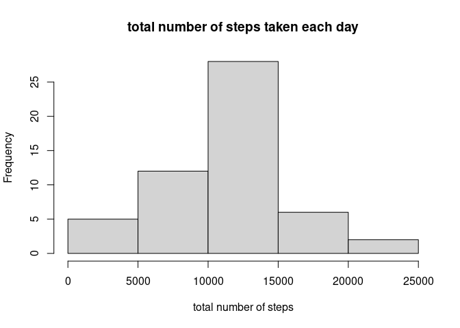
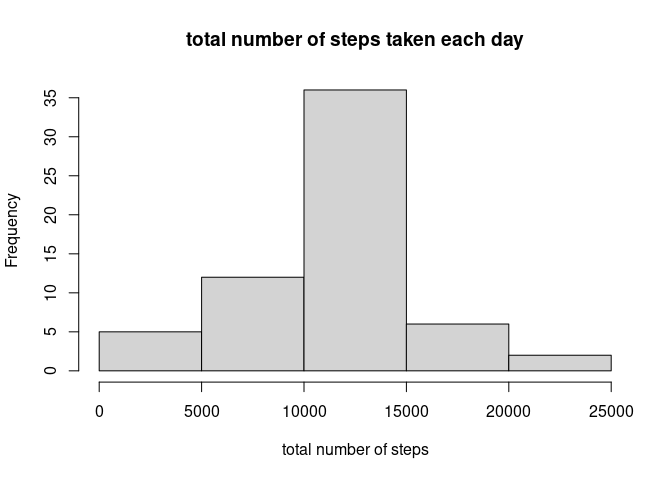
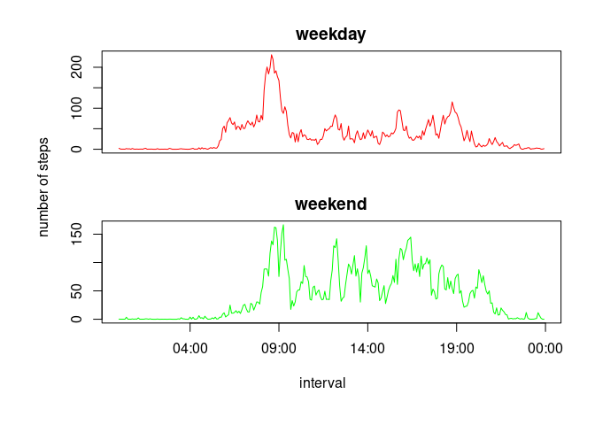

# Loading and preprocessing the data

## load the data

```r
unzip("activity.zip")
activity<-read.csv("activity.csv", head=TRUE)
```
## transform the data variable

```r
str(activity)
```

```
## 'data.frame':	17568 obs. of  3 variables:
##  $ steps   : int  NA NA NA NA NA NA NA NA NA NA ...
##  $ date    : chr  "2012-10-01" "2012-10-01" "2012-10-01" "2012-10-01" ...
##  $ interval: int  0 5 10 15 20 25 30 35 40 45 ...
```

```r
install.packages("lubridate")
```

```
## Installing package into '/usr/local/lib/R/site-library'
## (as 'lib' is unspecified)
```

```r
library(lubridate)
```

```
## 
## Attaching package: 'lubridate'
```

```
## The following objects are masked from 'package:base':
## 
##     date, intersect, setdiff, union
```

```r
library(dplyr)
```

```
## 
## Attaching package: 'dplyr'
```

```
## The following objects are masked from 'package:stats':
## 
##     filter, lag
```

```
## The following objects are masked from 'package:base':
## 
##     intersect, setdiff, setequal, union
```

```r
activity<-activity %>% mutate(dataform=as.Date(activity$date))%>% mutate(weekday=wday(dataform,label=TRUE))
```

# What is mean total number of steps taken per day?
## total number of steps of each day

```r
sum_steps<-tapply(activity$steps,activity$date,sum)
```
## Histogram of the total number of steps taken each day

```r
hist(sum_steps, main="total number of steps taken each day", xlab="total number of steps")
```

<!-- -->
##Mean and median number of steps taken each day

```r
mean_daysteps<-mean(sum_steps,na.rm=TRUE)
median_daysteps<-median(sum_steps,na.rm=TRUE)
print (mean_daysteps)
```

```
## [1] 10766.19
```

```r
print (median_daysteps)
```

```
## [1] 10765
```

# What is the average daily activity pattern?
## Time series plot of the average number of steps taken

```r
activity_mean<- activity %>% group_by(interval)%>% summarise(steps_mean=mean(steps,na.rm=TRUE))
```

```
## `summarise()` ungrouping output (override with `.groups` argument)
```

```r
activity_mean<- activity_mean %>% mutate(hour=interval %/% 100, minute= interval%% 100, time_slot=sprintf("%02d:%02d",hour,minute), formal_time=strptime(time_slot,format="%H:%M"))
plot(activity_mean$formal_time,activity_mean$steps_mean,type="l",xlab="Time interval",ylab="average steps")
```

<!-- -->
##The 5-minute interval that, on average, contains the maximum number of steps


```r
activity_mean$interval[which.max(activity_mean$steps_mean)]
```

```
## [1] 835
```

# Imputing missing values

## inspect into the missing value

```r
sum_missing<-sum(is.na(activity))
print(sum_missing)
```

```
## [1] 2304
```

```r
missing_col<-numeric(ncol(activity))
for (i in 1: ncol(activity))
{ missing_col[i]= sum(is.na(activity[,i]))
}
names(missing_col)<-names(activity)
print(missing_col)
```

```
##    steps     date interval dataform  weekday 
##     2304        0        0        0        0
```
## imputing missing data

```r
activity<-activity%>% group_by(interval)%>% mutate(mean_steps = mean(steps,na.rm=TRUE))%>% ungroup()
activity_2<-activity%>% mutate(steps = ifelse(is.na(steps), mean_steps,steps))
```
##Histogram of the total number of steps taken each day after missing values are imputed

```r
sum_steps_2<-activity_2%>% group_by(date)%>% summarize(sum_steps=sum(steps))
```

```
## `summarise()` ungrouping output (override with `.groups` argument)
```

```r
hist(sum_steps_2$sum_steps,main="total number of steps taken each day", xlab="total number of steps")
```

<!-- -->
## mean and median of steps

```r
mean_daysteps_2<-mean(sum_steps_2$sum_steps)
median_daysteps_2<-median(sum_steps_2$sum_steps)
print (mean_daysteps_2)
```

```
## [1] 10766.19
```

```r
print (median_daysteps_2)
```

```
## [1] 10766.19
```

# Are there differences in activity patterns between weekdays and weekends?


```r
activity_2<-activity_2%>% mutate(day_week=ifelse(weekday %in% c("Sat","Sun"),"Weekend","Weekday"))
mean_step<- activity_2 %>% group_by( day_week,interval)%>% summarise( step_mean= mean(steps))
```

```
## `summarise()` regrouping output by 'day_week' (override with `.groups` argument)
```

```r
mean_step<-mean_step%>% mutate( hour=interval %/%100, minute=interval%%100,time_2=sprintf("%02d:%02d",hour,minute), time_formal=strptime(time_2,"%H:%M"))
ungroup(mean_step)
```

```
## # A tibble: 576 x 7
##    day_week interval step_mean  hour minute time_2 time_formal        
##    <chr>       <int>     <dbl> <dbl>  <dbl> <chr>  <dttm>             
##  1 Weekday         0    2.25       0      0 00:00  2026-11-07 00:00:00
##  2 Weekday         5    0.445      0      5 00:05  2026-11-07 00:05:00
##  3 Weekday        10    0.173      0     10 00:10  2026-11-07 00:10:00
##  4 Weekday        15    0.198      0     15 00:15  2026-11-07 00:15:00
##  5 Weekday        20    0.0990     0     20 00:20  2026-11-07 00:20:00
##  6 Weekday        25    1.59       0     25 00:25  2026-11-07 00:25:00
##  7 Weekday        30    0.693      0     30 00:30  2026-11-07 00:30:00
##  8 Weekday        35    1.14       0     35 00:35  2026-11-07 00:35:00
##  9 Weekday        40    0          0     40 00:40  2026-11-07 00:40:00
## 10 Weekday        45    1.80       0     45 00:45  2026-11-07 00:45:00
## # … with 566 more rows
```

```r
weekday_data<-subset(mean_step,day_week=="Weekday")
weekend_data<-subset(mean_step,day_week=="Weekend")
par(mfrow=c(2,1),mar=c(2,2,2,1),oma=c(4,4,1,1))

with(weekday_data, plot(step_mean~time_formal,type="l",col="red",ylab="",main="weekday",xlab="",xaxt="n"))
with(weekend_data, plot(step_mean~time_formal,type="l",col="green",ylab="",main="weekend",xlab=""))
mtext("number of steps",outer= TRUE,side=2,line=1)
mtext("interval",side=1,outer=TRUE,line=1)
```

<!-- -->
